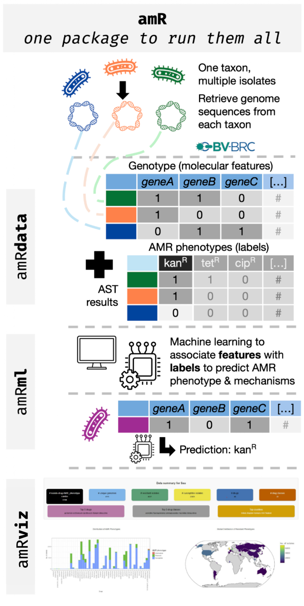

<!-- README.md is generated from README.Rmd. Please edit that file -->

```{r, include = FALSE}
knitr::opts_chunk$set(
  collapse = TRUE,
  comment = "#>",
  fig.path = "man/figures/README-",
  out.width = "100%"
)
```

# amR: an R package suite for antimicrobial resistance prediction

<!-- badges: start -->
[](https://lifecycle.r-lib.org/articles/stages.html#experimental)
<!-- badges: end -->

**amR** is a metapackage that provides a single installation point for the amR suite of packages for antimicrobial resistance (AMR) prediction in bacterial pathogens.

```{r, echo=FALSE, fig.align='center', out.width='60%'}

```

## The amR suite

The amR suite consists of three packages that work together:

| Package | Description | Repository |
|---------|-------------|------------|
| **amRdata** | Data curation and feature extraction from bacterial genomes | [JRaviLab/amRdata](https://github.com/JRaviLab/amRdata) |
| **amRml** | Machine learning models for AMR prediction | [JRaviLab/amRml](https://github.com/JRaviLab/amRml) |
| **amRviz** | Interactive dashboard for exploring results | [JRaviLab/amRviz](https://github.com/JRaviLab/amRviz) |

## Installation

### Install the entire suite

```r
# Install amR metapackage
if (!requireNamespace("remotes", quietly = TRUE))
    install.packages("remotes")

remotes::install_github("JRaviLab/amR")

# Then install all packages in the suite
library(amR)
installAMR()
```

### Install individual packages

You can also install packages individually:

```r
remotes::install_github("JRaviLab/amRdata")
remotes::install_github("JRaviLab/amRml")
remotes::install_github("JRaviLab/amRviz")
```

### Alternative: install with pak

```{r, eval = FALSE}
installAMR(method = "pak")
```

### Install from a specific branch

```{r, eval = FALSE}
# Same branch (or tag/commit) for every package
installAMR(branch = "dev")

# Per-package branches; others use their default branch
installAMR(branch = c(ml = "dev"))

# The metapackage itself, via pak
pak::pkg_install("JRaviLab/amR@dev")
```


## Quick start

```r
# Load all packages
library(amRdata)
library(amRml)
library(amRviz)

# 1. Prepare data with amRdata
# prepareGenomes("Shigella sonnei")
# runDataProcessing()

# 2. Train ML models with amRml
# runModelingWorkflow()
# rescoreFeatures()

# 3. Explore results with amRviz
# launchAMRDashboard(...)
```

## Workflow overview

```
┌─────────────┐     ┌─────────────┐     ┌─────────────┐
│  amRdata    │ --> │   amRml     │ --> │  amRviz   │
│             │     │             │     │             │
│ - Genomes   │     │ - Train LR  │     │ - Dashboard │
│ - Features  │     │ - Evaluate  │     │ - Plots     │
│ - Metadata  │     │ - Top feats │     │ - Export    │
└─────────────┘     └─────────────┘     └─────────────┘
```

## Documentation

- [amRdata documentation](https://jravilab.github.io/amRdata)
- [amRml documentation](https://jravilab.github.io/amRml)
- [amRviz documentation](https://jravilab.github.io/amRviz)

## Citation

**amR: an R package suite to predict antimicrobial resistance in bacterial pathogens**

Abhirupa Ghosh^, Evan P. Brenner^, Emily A. Boyer, Alexander P. McKim, Charmie K. Vang, Ethan P. Wolfe, David Mayer, Raymond L. Lesiyon, Janani Ravi. _bioRxiv_ (2026). doi: [10.64898/2026.07.10.734579](https://doi.org/10.64898/2026.07.10.734579)

^ _Co-first authors_

*Department of Biomedical Informatics, Center for Health Artificial Intelligence, University of Colorado Anschutz*

<details>
<summary>Abstract</summary>

Motivation: Identifying bacterial antimicrobial resistance (AMR) is critical for diagnostics and treatment, but resistance is a complex trait arising from myriad mechanisms spanning multiple molecular scales. Existing computational approaches often function as black boxes and rarely explore cross-species or multi-drug patterns. We developed amR, an integrated R package suite that provides a complete framework from bacterial genome data curation to interpretable AMR predictions, enabling identification of resistance mechanisms across species and drugs.

Results: The amR R package suite contains three modular packages. amRdata downloads genomes and paired antimicrobial susceptibility testing data from BV-BRC and processes them, constructs pangenomes, and extracts features at gene/protein cluster, protein domain, annotated Clusters of Orthologous Groups and ResFinder AMR-associated features, and structural variant scales; data are stored in memory-efficient formats (Parquet, DuckDB). amRml trains interpretable machine learning models per species-drug combination, calculates feature importance and performance metrics, and provides rich ground for hypothesis generation and mechanism discovery. amRviz provides an interactive Shiny dashboard to explore metadata distributions and model performance across species and drugs, visualize top predictive AMR features, and analyze cross-model patterns across geographic/temporal strata. We apply the suite to _Shigella sonnei_, achieving a median Matthews Correlation Coefficient of 0.89 across 23 drugs and drug classes. With thousands of genomes, multi-scale features, and interpretable models, amR provides an accessible, comprehensive framework for AMR research. The amR package suite is installable via GitHub (https://github.com/JRaviLab/amR; BSD-3-Clause license).

</details>

### How to cite

If you use the amR suite in your research, please cite:

> Ghosh A^, Brenner EP^, Boyer EA, McKim AP, Vang CK, Wolfe EP, Mayer D, Lesiyon RL, Ravi J.
>
> amR: an R package suite to predict antimicrobial resistance in bacterial pathogens.
>
> bioRxiv. 2026. DOI: [10.64898/2026.07.10.734579](https://doi.org/10.64898/2026.07.10.734579).

^ Co-first authors

Looking for a cool application of this amR prediction framework? Check out our recent work on predicting AMR in ESKAPE pathogens: [Ghosh^, Brenner^, Vang^, Wolfe^, _et al.,_ _bioRxiv_ 2025](https://doi.org/10.1101/2025.07.03.663053).


## Contributing

We welcome contributions! Please see [CONTRIBUTING.md](CONTRIBUTING.md) for guidelines.

## License

BSD 3-Clause License. See [LICENSE](LICENSE) for details.

## Contact

**Corresponding author**: Janani Ravi (janani.ravi@cuanschutz.edu)

**Lab website**: https://jravilab.github.io

## Code of Conduct

Please note that amR is released with a [Contributor Code of Conduct](https://contributor-covenant.org/version/2/1/CODE_OF_CONDUCT.html). By contributing to this project, you agree to abide by its terms.
